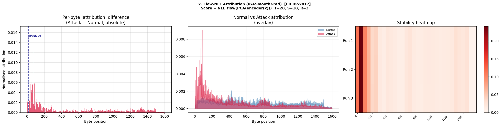

cat > README.md << 'EOF'
# Network Traffic Anomaly Detection
## CAFE-FKESE Framework

A semi-supervised network anomaly detection 
framework operating directly on raw packet 
bytes without feature engineering, trained 
exclusively on normal traffic.

## Framework Architecture

- **CAFE**: CNN-LSTM Autoencoding Feature Extractor  
  Transforms raw packet bytes into compact latent 
  representations using a Conv1d pyramid + 2-layer LSTM

- **FKESE**: Flow-KNN Ensemble Scoring Engine  
  Combines Normalizing Flow density estimation 
  (w=0.9) with KNN distance scoring (w=0.1)

- **YOBDM**: Youden-Optimal Binary Decision Module  
  Data-driven threshold using Youden's J statistic

---

## Results

| Script | Dataset | AUROC |
|--------|---------|-------|
| ciciot2023.py | CICIoT-2023 | 0.9828 |
| cicids2017.py | CICIDS2017  | 0.9655 |
| vpn.py        | ISCXVPN2016 | 0.9376 |
| tor.py        | ISCXTor2016 | 0.8899 |

---

## Explainability Module

The framework includes a post-hoc 
explainability module that attributes 
ensemble anomaly decisions 
(`0.9 × NLL_flow + 0.1 × KNN`) 
to individual raw input bytes. Since 
the ensemble score is non-differentiable, 
a score distillation surrogate (ScoreMLP, 
297.5K parameters, Spearman ρ = 0.9953) 
is trained to reproduce the full ensemble 
score, through which Integrated Gradients 
and SmoothGrad (T=20, S=10, R=3) are 
applied to identify the most anomalous 
byte regions.

### Explainability Notebook
`NLL Explainability.ipynb` — contains 
the full six-component validation pipeline:
- Data-level signal analysis
- Gradient-based attribution (IG+SmoothGrad)
- Statistical validation (bootstrap CI + permutation)
- Causal deletion/insertion experiments
- Model randomization sanity check
- Cross-method occlusion comparison

---

### Explainability Results — CICIDS2017

#### 1. Data-Level Mean Difference (Model-Free Ground Truth)


Attack packets (DoS Hulk, GoldenEye, Slowloris) 
exhibit sharp byte-value spikes at bytes 0–100 
(reaching 0.95–1.0), corresponding to HTTP flood 
headers. Top discriminative windows: 
bytes 50–99 (Δ=9.66), 0–49 (Δ=8.70), 
100–149 (Δ=5.11).

---

#### 2. Ensemble Surrogate Attribution (IG+SmoothGrad)


Score: `ScoreMLP(0.9×NLL_flow + 0.1×KNN)`, 
Spearman ρ=0.9953. Attribution peak at bytes 
0–100 (≈0.016), matching data-level ground truth. 
Top windows: bytes 50–99 (imp=0.241), 
0–49 (=0.115), 100–149 (=0.103). 
Stability heatmap confirms reproducibility 
across R=3 independent runs.

---

#### 3. Bootstrap CI + Permutation Test


5/32 windows significant at p<0.05 using 
corrected packet-resampled bootstrap (B=1000). 
Two windows reach p<0.001 (bytes 50–99, 100–149). 
All 32/32 importance values within own 95% CI.

| Window | Importance | 95% CI | p-value |
|--------|-----------|--------|---------|
| Bytes 50–99 | 0.241 | [0.204, 0.267] | <0.001 |
| Bytes 0–49 | 0.115 | [0.096, 0.128] | 0.002 |
| Bytes 100–149 | 0.103 | [0.085, 0.116] | <0.001 |
| Bytes 150–199 | 0.065 | [0.052, 0.076] | 0.004 |
| Bytes 250–299 | 0.041 | [0.032, 0.049] | 0.018 |

---

#### 4. Causal Deletion/Insertion Validation


Top-k attributed byte removal (AUC=-60.56) 
drops anomaly score faster than random removal 
(AUC=-52.42), ΔAUC=-8.14, confirming causal 
necessity. Insertion curve confirms causal 
sufficiency.

---

#### 5. Model Randomization Sanity Check


Spearman ρ=0.471 (p<0.001) between trained and 
randomized model attributions. Qualitatively 
different shapes (broad multi-peak vs single 
narrow spike) confirm trained representations 
contribute structured sensitivity beyond input 
variance alone.

---

#### 6. IG+SmoothGrad vs Occlusion Comparison


Spearman ρ=-0.137 (p=0.453, not significant), 
top-3 overlap: 1/3. Both methods agree bytes 
0–49 are causally important. Non-significant 
disagreement reflects methodological difference 
between path-integrated and marginal attribution.

---

## Requirements

```bash
pip install -r requirements.txt
```

## Usage

```bash
python "CIC IDS.py"
python "CIC IoT.py"
python TOR.py
python VPN.py

# Explainability
jupyter notebook "NLL Explainability.ipynb"
```

## Datasets

Download from University of New Brunswick (UNB):
- [CICIoT2023](https://www.unb.ca/cic/datasets/iotdataset-2023.html)
- [CICIDS2017](https://www.unb.ca/cic/datasets/ids-2017.html)
- [ISCXVPN2016](https://www.unb.ca/cic/datasets/vpn.html)
- [ISCXTor2016](https://www.unb.ca/cic/datasets/tor.html)

## Citation
